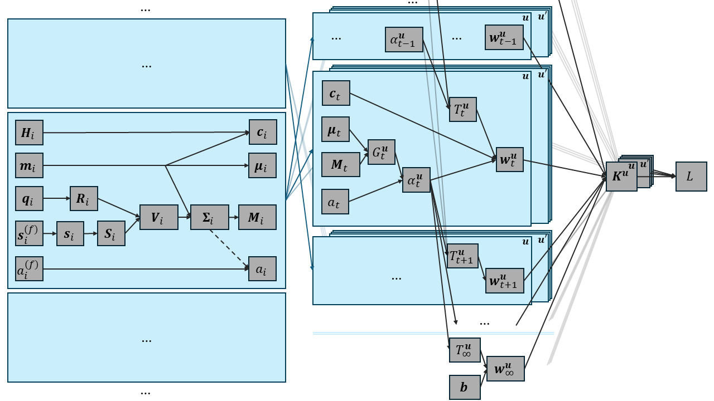

# Mathematics

This page describes 3D Gaussian splatting's [1] forward and backward passes mathematically. Occasionally we will also discuss how to translate this into code. Especially the gradient computations can help when reading (and writing!) the implementation.

## Forward
A trained 3DGS model consists of a collection of Gaussian primitives, each of which consists of
- a Gaussian function $\mathcal{G}_i = \mathcal{G}(\cdot; \vect{m}_i, \matr{V}_i): \mathbb{R}^3 \to (0, 1]$, where
    $$\mathcal{G}(\vect{x}; \vect{m}, \matr{V}) = \exp \left( -\frac{1}{2} (\vect{x} - \vect{m})^T \matr{V}^{-1} (\vect{x} - \vect{m}) \right)$$
    for any $\vect{x} \in \mathbb{R}^3$,
- an opacity $a_i \in (0, 1)$, and
- a viewpoint-dependent color, encoded by a matrix $\matr{H}_i \in \mathbb{R}^{h \times 3}$ of spherical harmonics (SH) coefficients, where $h = (d + 1)^2$ and $d \in \mathbb{N}$ is the SH degree ($d \leq 3$).

Note that the Gaussian function is not normalized. The parameter $\vect{m} \in \mathbb{R}^3$ determines the mean of the Gaussian, while $\matr{V} \in \mathbb{R}^{3 \times 3}$ is its covariance matrix, determining the shape. It can be decomposed into a rotation matrix $\matr{R} \in \mathbb{R}^{3 \times 3}$ and diagonal positive scaling matrix $\matr{S} \in \mathbb{R}^{3 \times 3}$, with $\matr{V} = \matr{R}\matr{S}\matr{S}^T \matr{R}$. Of course we only need to store the diagonal entries $\vect{s} \in \mathbb{R}_{> 0}^3$ of $\matr{S}$. The rotation is stored as a quaternion $\vect{q} \in \mathbb{R}^4$. All components of $\vect{s}$ need to be positive. To ensure this, we will store scaling features $\vect{s}^{(f)} \in \mathbb{R}^3$ with $s_j = \exp(s_j^{(f)})$. For similar reasons we also do not store the opacity $a$, but its logit $a^{(f)}$. In other words, $a$ is the sigmoid of its feature $a^{(f)}$.

### Projection phase

To render an image we now fix a camera, determined in particular by a projection matrix $\matr{P} \in \mathbb{R}^{3 \times 4}$. It maps a 3D point in homogeneous world coordinates into 2D homogeneous image coordinates. We will use continuous pixel coordinates where the top-left corner of the image plane is the origin $(0, 0)$. The top-left pixel, with discrete pixel coordinates $(1, 1)$ corresponds to the rectangle $(0, 1] \times (0, 1]$ with continuous center $(0.5, 0.5)$. We now project all 3D Gaussians $\mathcal{G}_i$ into 2D. If we linearize the perspective transformation (which using homogeneous coordinates is linear ($\matr{P}$), but not in Euclidean coordinates) at each $\vect{m}_i$ to a Jacobian $\matr{J}_i \in \mathbb{R}^{2 \times 3}$, then we obtain a 2D Gaussian $G_i = G_i(\cdot; \vect{\mu}_i, \matr{\Sigma}_i)$, where $\vect{\mu}_i$ is the dehomogenization of $\matr{P}$ applied to a homogenized version of $\vect{m}_i$, $\matr{\Sigma}_i = \matr{J}_i \matr{V}_i \matr{J}_i^T$, and the function rule is completely similar to the 3D version. Using the viewing direction determined by the camera optical center and $\vect{m}_i$ we can also decode $\matr{H}_i$ into a single RGB color $\vect{c}_i$.

Though somewhat of a detail, we also point out that $\matr{\Sigma}_i$ is dilated by adding to it a diagonal matrix. Write $\matr{\Sigma}_i^{(0)} = \matr{J}_i \matr{V}_i \matr{J}_i^T$ for the pre-dilated version and $\matr{\Sigma}_i^{(D)} = \matr{\Sigma}_i^{(0)} + \begin{pmatrix} D_1 & 0 \\ 0 & D_2 \end{pmatrix}$ for the version dilated via $\vect{D} \in \mathbb{R}_{\geq 0}^2$. When using antialiasing we also adjust the opacity as $a^{(D)} = \frac{\det \matr{\Sigma}_i^{(0)}}{\det \matr{\Sigma}_i^{(D)}} a^{(0)}$.

All 2D Gaussians are filtered on visibility (lying in the camera frustum (in front of the camera)) and sorted by depth (the homogeneous component of the 2D projection). The reference 3DGS implementation will use an extended screen boundary and clamp the 2D mean to this boundary, but only in the computation of $\matr{J}_i$, i.e. the location $\vect{\mu}_i$ of the 2D Gaussian is not clamped. Instead of clamping, we can also just remove a Gaussian if $\vect{\mu}_i$ falls outside of the extended boundary.

### Rendering phase

For each pixel $\vect{u} = (u, v)$ (horizontal, vertical) in the image to render we now consider the center point $(u - 0.5, v - 0.5)$. We compute blending weights $\alpha_j = G_j(u - 0.5, v - 0.5)$ for every (filtered, sorted) 2D Gaussian, as well as the transmittance $T_j = \prod_{k < j} (1 - \alpha_k)$. The resulting pixel color is finally
$$K^{\vect{u}} = \sum_j T_j \alpha_j \vect{c}_j \in \mathbb{R}^3.$$
We can include a background color $\vect{b} \in \mathbb{R}^3$ by adding $T_\infty \vect{b}$. Here $T_\infty$ is the transmittance after the furthest Gaussian.

### Efficiency tricks

A first thing to point out is that covariance matrices are symmetric, so we only need to store the lower halves of the $\matr{\Sigma}_i$ (and $\matr{V}_i$).

#### Filtering
How do we handle Gaussians which are not visible? The reference implementation just skips them within a large projection (3D $\to$ 2D) kernel using `return`. However, this leads to warp divergence. Instead, we will first have a kernel to determine visibility, store the indices of the visible Gaussians into a new array, and project only these. This means all threads are always active (though when a 2D Gaussian's bounding box (see below) for a thread is empty we will still perform less work on this thread). See also [2].

#### Tiling
For our pixel rendering formulas most $\alpha_j$ will be negligibly small, as Gaussians tend to zero very quickly. Instead of summing over all (filtered) 2D Gaussians, we should only sum over those which are sufficiently close to our pixel. This can be achieved by tiling the image to render, i.e. partition it into a regular grid of rectangles. Each tile will correspond to a thread-block, and each pixel in a tile to a thread in the block. To determine which 2D Gaussians are close, we construct axis-aligned bounding boxes for each of them. We use the tight non-square bounding boxes from [2]. Next, we check for each Gaussian which tiles they intersect, in the sense that their AABB overlaps with the tile rectangle. For each pixel in a tile we will now only sum over those Gaussians which intersect the tile.

#### Sorting
Recall that to obtain the output pixel color we need to sum over 2D Gaussians in depth-order. Therefore, we need to sort the 2D Gaussians assigned to a tile separately for each tile. To do this efficiently using a single sort, we will create duplicated (filtered 2D) Gaussians. More concretely, we create a list of filtered 2D Gaussian indices where each entry is repeated as many times as the number of tiles the Gaussian intersects. At the same time we also construct a list containing for each duplicated Gaussian a code containing in its highest bits the tile index and in its lowest bits the depth. A global sort on the list of codes, cosorting the indices, then results in per-tile depth-sorted duplicated Gaussians. In the tile rendering kernel we now sum over that part of the list corresponding to our tile. 

We will refer to the tiling, duplication and sorting as the tiling phase. Therefore, we have three phases:
+ projection phase
+ tiling phase
+ (tile) rendering phase.

#### Precomputations
When computing the $\alpha_j$ we need to evaluate the (duplicated) Gaussian function $G_j$ for every pixel in its tile. To make this more efficient, we can note that the argument within the exponential is a polynomial in the pixel coordinates. If we expand it to canonical form, this allows us to separate the arguments which only depend on the pixel location, and those which only depend on the Gaussian. The latter can then be precomputed for all pixels at once. See [2] for more information.

## Backward

### Computational graph
The description from the forward pass can roughly be visualized as follows.

Subscripts $i$ refer to 3D Gaussian primitives, while subscripts $t$ refer to duplicated filtered 2D Gaussians. We do not explicitly include the filtering step. Filtered-out Gaussians do not partake in the rendering and therefore do not receive any gradients. We can then view $i$ as already referring to filtered Gaussians.

The blocks on the left show the projection phase, where all Gaussians are handled independently. The blocks on the middle visualize the tile rendering phase, where different sorted duplicated Gaussians interact. The arrows in between the left and middle blocks show the duplication and sorting. Each $a_t$ corresponds to a single $a_i$, though multiple $a_t$ can correspond to the same $a_i$. In the tile rendering phase we also need the pixel location $\vect{u}$.

Leaving out the indices where possible, the variables in the computational graph are
*   $\matr{H} \in \mathbb{R}^{h \times 3}$: SH matrix
*   $\vect{m} \in \mathbb{R}^3$: 3D mean
*   $\vect{q} \in \mathbb{R}^4$: quaternion
*   $\matr{R} \in \mathbb{R}^{3 \times 3}$: rotation matrix
    * With $\hat{\vect{q}} = \vect{q} / \norm{q}_2 = (r, x, y, z)^T$, we have $\matr{R} = \begin{pmatrix} 1 - 2(y^2 + z^2) & 2(xy - rz) & 2(xz + ry) \\ 2(xy + rz) & 1 - 2(x^2 + z^2) & 2(yz - rx) \\ 2(xz - ry) & 2(yz + rx) & 1 - 2(x^2 + y^2)\end{pmatrix}$
*   $\vect{s}^{(f)} \in \mathbb{R}^3$: scaling features
*   $\vect{s} \in \mathbb{R}^3$: scaling vector
    *   $s_j = \exp(s_j^{(f)})$ for $j = 1, 2, 3$
*   $\matr{S} \in \mathbb{R}^{3 \times 3}$: scaling matrix
    *   $\vect{s}$ forms the diagonal entries, i.e. $S_{ij} = \delta_{ij} s_j$, where $\delta_{ij} = \begin{cases} 1 & \text{if } i = j \\ 0 & \text{else} \end{cases}$ is the Kronecker delta
*   $\matr{V} \in \mathbb{R}^{3 \times 3}$: 3D covariance matrix
    *   $\matr{V} = \matr{R} \matr{S} \matr{S}^T \matr{R}^T$
*   $a^{(f)} \in \mathbb{R}$: opacity feature
*   $\vect{c} \in \mathbb{R}_{\geq 0}^3$: color for the viewing direction $\vect{d} = \vect{m} - \vect{o}$, where $\vect{o}$ is the render camera optical center
    *   $c_j = \ReLU\left(\frac{1}{2} + \sum_i \beta_i(\hat{\vect{d}}) H_{ij}\right)$, where $\ReLU(x) = \max\{0, x\}$ and the $\beta_i$ are the (plenoxels) SH basis functions, which we evaluate in $\hat{\vect{d}} = \vect{d} / \norm{\vect{d}}$. The $\beta_i(\hat{\vect{d}})$ can be written in terms of the components of $\hat{\vect{d}} = (x, y, z)^T$ and certain constants $\lambda_i$:
        *   $\beta_1(\hat{\vect{d}}) = \lambda_1$
        *   $\beta_2(\hat{\vect{d}}) = -\lambda_2 y$
        *   $\beta_3(\hat{\vect{d}}) = \lambda_3 z$
        *   $\beta_4(\hat{\vect{d}}) = -\lambda_4 x$
        *   $\beta_5(\hat{\vect{d}}) = \lambda_5 xy$
        *   $\beta_6(\hat{\vect{d}}) = \lambda_6 yz$
        *   $\beta_7(\hat{\vect{d}}) = \lambda_7 (2z^2 - x^2 - y^2)$
        *   $\beta_8(\hat{\vect{d}}) = \lambda_8 xz$
        *   $\beta_9(\hat{\vect{d}}) = \lambda_9 (x^2 - y^2)$
        *   $\beta_{10}(\hat{\vect{d}}) = \lambda_{10} (3x^2 - y^2) y$
        *   $\beta_{11}(\hat{\vect{d}}) = \lambda_{11} xyz$
        *   $\beta_{12}(\hat{\vect{d}}) = \lambda_{12} (4z^2 - x^2 - y^2)y$
        *   $\beta_{13}(\hat{\vect{d}}) = \lambda_{13} (2z^2 - 3(x^2 + y^2))z$
        *   $\beta_{14}(\hat{\vect{d}}) = \lambda_{14} (4z^2 - x^2 - y^2)x$
        *   $\beta_{15}(\hat{\vect{d}}) = \lambda_{15} (x^2 - y^2)z$
        *   $\beta_{16}(\hat{\vect{d}}) = \lambda_{16} (x^2 - 3y^2)x$
        We go no higher as we support only up to SH degree 3 $(h \leq 16)$.
*   $\vect{\mu} \in \mathbb{R}^2$: projected 2D mean
    *   $(r\vect{\mu}^T, r)^T = \matr{P} (\vect{m}^T, 1)^T$, where $\matr{P} \in \mathbb{R}^{3 \times 3}$ is the render camera projection matrix and $r$ is the Gaussian's depth
*   $\matr{\Sigma} \in \mathbb{R}^2$: projected 2D covariance matrix
    *   $\matr{\Sigma} = \matr{J} \matr{V} \matr{J}^T + \begin{pmatrix} D_1 & 0 \\ 0 & D_2 \end{pmatrix}$, where $\matr{J}$ is the Jacobian of the perspective projection using to go from $\vect{m}$ to $\vect{\mu}$:
        *   Write $\vect{p} = (p, q, r)^T = \matr{P} (\vect{m}^T, 1)^T = \matr{P}_{1:3, 1:3} \vect{m} + \matr{P}_{1:3, 4}$ for the homogeneous version of $\vect{\mu} = (p/r, q/r)^T$. Then $\matr{J} = \pdiff{\vect{\mu}}{\vect{m}} = \pdiff{\vect{\mu}}{\vect{p}} \pdiff{\vect{p}}{\vect{m}} = \begin{pmatrix} 1/r & 0 & -p/r^2 \\ 0 & 1/r & -q/r^2 \end{pmatrix} \matr{P}_{1:3, 1:3} = \begin{pmatrix} 1/r & 0 & -\mu_1/r \\ 0 & 1/r & -\mu_2/r \end{pmatrix} \matr{P}_{1:3, 1:3}$.
        * If we use clamping, simply replace $\vect{\mu}$ by its clamped version.
*   $\matr{M} = \matr{\Sigma}^{-1}$: inverse 2D covariance matrix (used in the Gaussian function evaluation)
    *   $\matr{M} = \frac{1}{\Sigma_{11} \Sigma_{22} - \Sigma_{21}^2}\begin{pmatrix} \Sigma_{22} & -\Sigma_{21} \\ -\Sigma_{21} & \Sigma_{11} \end{pmatrix}$, where we used that $\matr{\Sigma}$ is symmetric
*   $a \in (0, 1)$: opacity
    *   $a = \sigma(a^{(f)}) = \frac{1}{1 + \exp(-a^{(f)})}$; $\sigma$ is the sigmoid function
    *   If we use antialiasing: $a = a^{(D)} = \frac{\det \matr{\Sigma}_i^{(0)}}{\det \matr{\Sigma}_i^{(D)}} a^{(0)}$ for $a^{(0)} = \sigma(a^{(f)})$ as above.

For the tile rendering the variables $\vect{c}_t$, $\vect{\mu}_t$, $\matr{M}_t$ and $a_t$ are identical to the ones from the projection phase (pre-duplication).
*   $G_t^{\vect{u}} \in (0, 1]$: the evaluation of the $t$-th duplicated Gaussian function at pixel $\vect{u}$
    *   $G_t^{\vect{u}} = \exp \left(-1/2 (\tilde{\vect{u}} - \vect{\mu}_t)^T \matr{M}_t (\tilde{\vect{u}} - \vect{\mu}_t) \right)$, where $\tilde{\vect{u}} = \vect{u} - (0.5, 0.5)^T$ contains the continuous center of discrete pixel $\vect{u}$
*   $\alpha_t^{\vect{u}} \in (0, a_t] \subseteq (0, 1]$
    *   $\alpha_t^{\vect{u}} = a_t G_t^{\vect{u}}$
*   $T_t^{\vect{u}} \in [0, 1]$: the transmittance in front of duplicated Gaussian $t$ (on the ray connecting the camera center and the pixel center)
    *   $T_t^{\vect{u}} = \prod_{s < t} (1 - \alpha_s^{\vect{u}})$
    *   $T_\infty^{\vect{u}} = \prod_s (1 - \alpha_s^{\vect{u}})$: the transmittance after the last duplicated Gaussian
*   $\vect{b} \in [0, 1]^3$: background color
    * (In principle we could use a background image instead of a single color, in which case we would have $\vect{b}^{\vect{u}}$.)
*   $\vect{w}_t^{\vect{u}} \in \mathbb{R}_{\geq 0}^3$: weighted color contribution of duplicated Gaussian $t$ to the pixel color
    *   $\vect{w}_t^{\vect{u}} = T_t^{\vect{u}} \alpha_t^{\vect{u}} \vect{c}_t$
    *   $\vect{w}_\infty^{\vect{u}} = T_\infty^{\vect{u}} \vect{b}$
        * If we write $\alpha_\infty^{\vect{u}} = 1$ and $\vect{c}_\infty = \vect{b}$, then we no longer need to distinguish this case.
*   $\vect{K}^{\vect{u}} \in \mathbb{R}_{\geq 0}^3$: rendered pixel color (not clamped to $1$) at pixel $\vect{u}$
    *   $\vect{K}^{\vect{u}} = \sum_t \vect{w}_t^{\vect{u}}$

Finally, we compare the rendered image to a ground truth image $\matr{I} \in [0, 1]^{3 \times w \times h}$ taken using the same camera parameters to compute a loss. Here $w$ is the image width (unrelated to the $\vect{w}_t^{\vect{u}}$) and $h$ the height. Note that in the implementation we might use a different memory order.
*   $L \in \mathbb{R}_{\geq 0}$: weighted average of L1 loss and $\DSSIM = 1 - \SSIM$
    *   $L = (1 - \lambda) \sum_{\vect{u}, k} \abs{K^{\vect{u}}_k - I^{\vect{u}}_k} + \lambda \DSSIM(\matr{K}, \matr{I})$ for some $\lambda \in (0, 1)$

### Gradients

Using the chain rule, we backpropagate the loss towards the Gaussian primitive parameters, using vector-Jacobian products (VJPs).
*   $\pdiff{L}{\matr{K}} \in \mathbb{R}^{1 \times (3 \times w \times h)}$
    *   For the gradients of the DSSIM, we refer to [FastCUDASSIM.jl](https://laurensdiels.github.io/FastCUDASSIM.jl/stable/math/)
    *   The gradient of the L1-loss is an 'image' with at pixel $\vect{u}$ and color component $k$ the value $1$ if $K^{\vect{u}}_k \geq I^{\vect{u}}_k$ and $-1$ otherwise.

We now again fix a pixel $\vect{u}$, hence we only need $\pdiff{L}{\vect{K}^{\vect{u}}} \in \mathbb{R}^{1 \times 3}$. We also fix a duplicated Gaussian index $t$.
*   $\pdiff{L}{\vect{w}_t^{\vect{u}}} = \pdiff{L}{\vect{K}^{\vect{u}}} \pdiff{\vect{K}^{\vect{u}}}{\vect{w}_t^{\vect{u}}} = \pdiff{L}{\vect{K}^{\vect{u}}} \in \mathbb{R}^{1 \times 3}$
    *   as the Jacobian $\pdiff{\vect{K}^{\vect{u}}}{\vect{w}_t^{\vect{u}}}$ is diagonal (color components do not interact) and each diagonal entry is $1$.
*   $\pdiff{L}{T_t^{\vect{u}}} = \pdiff{L}{\vect{w}_t^{\vect{u}}}\pdiff{\vect{w}_t^{\vect{u}}}{T_t^{\vect{u}}} = \alpha_t^{\vect{u}} \pdiff{L}{\vect{K}^{\vect{u}}} \vect{c}_t \in \mathbb{R}$
    * (Note that we have an inner product over the color components.)
*   $\pdiff{L}{\alpha_t^{\vect{u}}} = \pdiff{L}{\vect{w}_t^{\vect{u}}} \pdiff{\vect{w}_t^{\vect{u}}}{\alpha_t^{\vect{u}}} + \sum_{\tau > t} \pdiff{L}{T_\tau^{\vect{u}}} \pdiff{T_\tau^{\vect{u}}}{\alpha_t^{\vect{u}}} \in \mathbb{R}$
    *   $\pdiff{\vect{w}_t^{\vect{u}}}{\alpha_t^{\vect{u}}} = T_t^{\vect{u}} \vect{c}_t$
    *   $\pdiff{T_\tau^{\vect{u}}}{\alpha_t^{\vect{u}}} = - \prod_{s < \tau, s \neq t} (1 - \alpha_s^{\vect{u}}) = -\frac{1}{1 - \alpha_t^{\vect{u}}} T_\tau^{\vect{u}}$
    *   $\Rightarrow \pdiff{L}{\alpha_t^{\vect{u}}} = T_t^{\vect{u}} \pdiff{L}{\vect{K}^{\vect{u}}} \vect{c}_t - \frac{1}{1 - \alpha_t^{\vect{u}}} \sum_{\tau > t} T_\tau^{\vect{u}} \alpha_\tau^{\vect{u}} \pdiff{L}{\vect{K}^{\vect{u}}} \vect{c}_\tau = \pdiff{L}{\vect{K}^{\vect{u}}} \left(T_t^{\vect{u}} \vect{c}_t - \frac{1}{1 - \alpha_t^{\vect{u}}} \sum_{\tau > t} T_\tau^{\vect{u}} \alpha_\tau^{\vect{u}} \vect{c}_\tau \right) = \pdiff{L}{\vect{K}^{\vect{u}}} \left(T_t^{\vect{u}} \vect{c}_t - \frac{1}{1 - \alpha_t^{\vect{u}}} \sum_{\tau > t} \vect{w}_\tau^{\vect{u}} \right) = \frac{1}{1 - \alpha_t^{\vect{u}}} \pdiff{L}{\vect{K}^{\vect{u}}} \left(T_t^{\vect{u}} \vect{c}_t - \sum_{\tau \geq t} \vect{w}_\tau^{\vect{u}} \right)$
        * (Note that in the last form we only need to divide by $1 - \alpha_t^{\vect{u}}$ once, while in the penultimate form we need to do this for each of the 3 color components)
    *   This sum $\vect{\psi}_t^{\vect{u}} = \sum_{\tau \geq t} \vect{w}_\tau^{\vect{u}}$ can be efficiently computed incrementally:
        * In front-to-back order: $\vect{\psi}_1^{\vect{u}} = \vect{K}^{\vect{u}}$ and $\vect{\psi}_{t + 1}^{\vect{u}} = \vect{\psi}_t^{\vect{u}} - \vect{w}_t^{\vect{u}}$
            *   Note that $T_1^{\vect{u}} = 1$ and $T_{t + 1}^{\vect{u}} = (1 - \alpha_t) T_t^{\vect{u}}$, so that also the first part of $\pdiff{L}{\alpha_t^{\vect{u}}}$ is easy to compute (this is what we do in the forward pass)
        * In back-to-front order: $\vect{\psi}_\infty^{\vect{u}} = T_\infty^{\vect{u}} \vect{b}$ and $\vect{\psi}_t^{\vect{u}} = \vect{\psi}_{t + 1}^{\vect{u}} + \vect{w}_t^{\vect{u}}$
            *   $T_\infty^{\vect{u}}$ must be stored in the forward pass, $T_t^{\vect{u}} = \frac{1}{1 - \alpha_t} T_{t + 1}^{\vect{u}}$
*   $\pdiff{L}{G_t^{\vect{u}}} = \pdiff{L}{\alpha_t^{\vect{u}}} \pdiff{\alpha_t^{\vect{u}}}{G_t^{\vect{u}}} = a_t \pdiff{L}{\alpha_t^{\vect{u}}} \in \mathbb{R}$

We will temporarily introduce extra per-pixel (and still per duplicated Gaussian) variables $a_t^{\vect{u}}$, $\matr{M}_t^{\vect{u}}$, $\vect{\mu}_t^{\vect{u}}$ and $\vect{c}_t^{\vect{u}}$. Their values are the same as the (tile-)global variants (with only subscript $t$).
*   $\pdiff{L}{a_t^{\vect{u}}} = \pdiff{L}{\alpha_t^{\vect{u}}} \pdiff{\alpha_t^{\vect{u}}}{a_t^{\vect{u}}} = G_t^{\vect{u}} \pdiff{L}{\alpha_t^{\vect{u}}} \in \mathbb{R}$
    *   Note that the right hand side could never be $\pdiff{L}{a_t}$, as it depends on $\vect{u}$
*   $\pdiff{L}{\matr{M}_t^{\vect{u}}} = \pdiff{L}{G_t^{\vect{u}}} \pdiff{G_t^{\vect{u}}}{\matr{M}_t^{\vect{u}}} = -\frac{G_t^{\vect{u}}}{2} \pdiff{L}{G_t^{\vect{u}}} (\tilde{\vect{u}} - \vect{\mu}_t) (\tilde{\vect{u}} - \vect{\mu}_t)^T \in \mathbb{R}^{1 \times (2 \times 2)}$
    *   (In case your matrix calculus is a bit rusty, for any vector $\vect{z}$ and matrix $\matr{A}$ we have $\vect{z}^T \matr{A} \vect{z} = \sum_{\alpha, \beta} z_\alpha A_{\alpha \beta} z_\beta$. The partial derivative with respect to $A_{ij}$ is then $z_i z_j = \left(\vect{z} \vect{z}^T\right)_{ij}$. Therefore, $\pdiff{\left(\vect{z}^T \matr{A} \vect{zv}\right)}{\matr{A}} = \left(\pdiff{\left(\vect{z}^T \matr{A} \vect{z}\right)}{A_{ij}}\right)_{ij} = \vect{z} \vect{z}^T$.)
    *  We can rewrite this to $\pdiff{L}{\matr{M}_t^{\vect{u}}} = -\frac{\alpha_t^{\vect{u}}}{2} \pdiff{L}{\alpha_t^{\vect{u}}}(\tilde{\vect{u}} - \vect{\mu}_t) (\tilde{\vect{u}} - \vect{\mu}_t)^T$, using the expression for $\pdiff{L}{G_t^{\vect{u}}}$ and the fact that $\alpha_t^{\vect{u}} = a_t G_t^{\alpha_u}$
*   $\pdiff{L}{\vect{\mu}_t^{\vect{u}}} = \pdiff{L}{G_t^{\vect{u}}} \pdiff{G_t^{\vect{u}}}{\matr{\mu}_t^{\vect{u}}} = G_t^{\vect{u}} \pdiff{L}{G_t^{\vect{u}}} (\tilde{\vect{u}} - \vect{\mu}_t)^T \matr{M}_t^{\vect{u}} \in \mathbb{R}^{1 \times 2}$
    *   ($\pdiff{\left(\vect{z}^T \matr{A} \vect{z}\right)}{\vect{z}} = \left(\pdiff{\left(\sum_{\alpha, \beta} z_\alpha A_{\alpha \beta} z_\beta \right)}{z_i}\right)_{1i} = \left(\sum_{\alpha, \beta} A_{\alpha \beta}\pdiff{\left( z_\alpha z_\beta \right)}{z_i}\right)_{1i} = \left(\sum_{\alpha, \beta} A_{\alpha \beta} \left(\pdiff{z_\alpha}{z_i} z_\beta + z_\alpha \pdiff{z_\beta}{z_i} \right) \right)_i = \left(\sum_{\alpha, \beta} A_{\alpha \beta} \left(\delta_{\alpha i} z_\beta + z_\alpha \delta_{\beta i} \right) \right)_{1i} = \left(\sum_{\beta} A_{i \beta} z_\beta + \sum_{\alpha} A_{\alpha i} z_\alpha \right)_{1i} = \left((\matr{A} \vect{z})_i + (\matr{A}^T \vect{z})_i \right)_{1i} = \left((\matr{A} + \matr{A}^T)\vect{z} \right)^T = \vect{z}^T(\matr{A} + \matr{A}^T)$. Our covariance matrix is symmetric, so we get $2\matr{A}\vect{z}$.)
    *   $\pdiff{L}{\vect{\mu}_t^{\vect{u}}} = \alpha_t^{\vect{u}} \pdiff{L}{\alpha_t^{\vect{u}}} (\tilde{\vect{u}} - \vect{\mu}_t)^T \matr{M}_t^{\vect{u}}$
*   $\pdiff{L}{\vect{c}_t^{\vect{u}}} = \pdiff{L}{\vect{w}_t^{\vect{u}}} \pdiff{\vect{w}_t^{\vect{u}}}{\vect{c}_t^{\vect{u}}} = T_t^{\vect{u}} \alpha_t^{\vect{u}} \pdiff{L}{\matr{K}^{\vect{u}}} \in \mathbb{R}^{1 \times 3}$

To go from the duplicated per-pixel $\cdot_t^{\vect{u}}$ versions to original $\cdot_i$ ones, we need to sum over the pixels and (sorted) duplicated Gaussians corresponding to $i$, i.e. those with non-duplicated indices $i(t) = i$.
*    $\pdiff{L}{a_i} = \sum_{t: i(t) = i} \sum_{\vect{u}} \pdiff{L}{a_t^{\vect{u}}} = \sum_{t: i(t) = i} \sum_{\vect{u}} G_t^{\vect{u}} \pdiff{L}{\alpha_t^{\vect{u}}}$
*   $\pdiff{L}{\matr{M}_i} = -\frac{1}{2} \sum_{t: i(t) = i} \sum_{\vect{u}}  \alpha_t^{\vect{u}} \pdiff{L}{\alpha_t^{\vect{u}}}(\tilde{\vect{u}} - \vect{\mu}_t)^T(\tilde{\vect{u}} - \vect{\mu}_t)$
*   $\pdiff{L}{\vect{\mu}_i} = \sum_{t: i(t) = i} \sum_{\vect{u}} \alpha_t^{\vect{u}} \pdiff{L}{\alpha_t^{\vect{u}}} (\tilde{\vect{u}} - \vect{\mu_t}) \matr{M}_t$ 
    *   ($= \left(\sum_{t: i(t) = i} \sum_{\vect{u}} \alpha_t^{\vect{u}} \pdiff{L}{\alpha_t^{\vect{u}}} (\tilde{\vect{u}} - \vect{\mu_i})\right) \matr{M}_i$)
*   $\pdiff{L}{\vect{c}_i} = \sum_{t: i(t) = i} \sum_{\vect{u}} T_t^{\vect{u}} \alpha_t^{\vect{u}} \pdiff{L}{\matr{K}^{\vect{u}}}$
The reduction over $\vect{u}$ can be handled on the thread-block level. For the reduction over $t$ we need atomics. 

In the projection phase we can again drop the subscripts.
*   $\pdiff{L}{\matr{H}} = \pdiff{L}{\vect{c}} \pdiff{\vect{c}}{\matr{H}} \in \mathbb{R}^{1 \times (h \times 3)}$
    *   $\pdiff{\vect{c}}{\matr{H}} \in \mathbb{R}^{3 \times (h \times 3)}$
        *   $\ReLU'(x) = \delta_{x \geq 0} = \begin{cases} 1 & \text{if } x \geq 0 \\ 0 & \text{else} \end{cases}$ (it does not really matter what we do when $x = 0$)
        *   If $c_j \geq 0$, then $\pdiff{c_j}{H_{kl}} = \pdiff{}{H_{kl}} \left(\sum_i \beta_i(\hat{\vect{d}}) H_{ij}\right) = \beta_k(\hat{\vect{d}}) \delta_{jl}$
    *   $\pdiff{L}{H_{kl}} = \sum_j \pdiff{L}{c_j} \pdiff{c_j}{H_{kl}} = \delta_{c_l \geq 0} \pdiff{L}{c_l} \beta_k(\hat{\vect{d}})$
*    $\pdiff{L}{\matr{\Sigma}} = \pdiff{L}{\matr{M}} \pdiff{\matr{M}}{\matr{\Sigma}} \in \mathbb{R}^{1 \times (2 \times 2)}$
    *   $\pdiff{\matr{M}}{\matr{\Sigma}} \in \mathbb{R}^{(2 \times 2) \times (2 \times 2)}$
        * Let $\matr{\Sigma} = \begin{pmatrix} p & q \\ r & s \end{pmatrix}$ (ignoring symmetry, we will come back to this). Then $\matr{M} = \matr{\Sigma}^{-1} = \begin{pmatrix} \frac{s}{ps - qr} & -\frac{r}{ps - qr} \\ -\frac{q}{ps - qr} & \frac{p}{ps - qr} \end{pmatrix}$, with derivatives
            *   $\pdiff{\matr{M}}{p} = \begin{pmatrix} -\frac{s^2}{(ps - qr)^2} & \frac{rs}{(ps - qr)^2} \\ \frac{qs}{(ps - qr)^2} & -\frac{qr}{(ps - qr)^2} \end{pmatrix}$
            *   $\pdiff{\matr{M}}{q} = \begin{pmatrix} \frac{rs}{(ps - qr)^2} & -\frac{r^2}{(ps - qr)^2} \\ -\frac{ps}{(ps - qr)^2} & \frac{pr}{(ps - qr)^2} \end{pmatrix}$
            *   $\pdiff{\matr{M}}{r} = \begin{pmatrix} \frac{qs}{(ps - qr)^2} & -\frac{ps}{(ps - qr)^2} \\ -\frac{q^2}{(ps - qr)^2} & \frac{pq}{(ps - qr)^2} \end{pmatrix}$
            *   $\pdiff{\matr{M}}{s} = \begin{pmatrix} -\frac{qr}{(ps - qr)^2} & \frac{pr}{(ps - qr)^2} \\ \frac{pq}{(ps - qr)^2} & -\frac{p^2}{(ps - qr)^2} \end{pmatrix}$
        * If we write $\matr{M} = \begin{pmatrix} a & b \\ c & d \end{pmatrix}$, then
            *   $\pdiff{\matr{M}}{p} = \begin{pmatrix} -a^2 & -ab \\ -ac & -bc \end{pmatrix}$
            *   $\pdiff{\matr{M}}{q} = \begin{pmatrix} -ab & -b^2 \\ -ad & -bd \end{pmatrix}$
            *   $\pdiff{\matr{M}}{r} = \begin{pmatrix} -ac & -ad \\ -c^2 & -cd \end{pmatrix}$
            *   $\pdiff{\matr{M}}{s} = \begin{pmatrix} -bc & -bd \\ -cd & -d^2 \end{pmatrix}$
    * There is not much structure to exploit, so we will have to compute $\pdiff{L}{\matr{\Sigma}}$ simply as a 'matrix' product.
    * If we use antialiasing we have $\Sigma = \Sigma^{(D)}$ and we need to add the term $\pdiff{L}{a} \pdiff{a}{\matr{\Sigma}}$, where $a = a^{(D)}$ (and is unrelated to the notation for $\matr{M}$ above).
        *   $\pdiff{a^{(D)}}{\matr{\Sigma}^{(D)}} \in \mathbb{R}^{1 \times (2 \times 2)}$
            *   $\matr{\Sigma}^{(0)} = \begin{pmatrix} p - D_1 & q \\ r & s - D_2 \end{pmatrix}$
            *   $a^{(D)} = \frac{\det \matr{\Sigma}^{(0)}}{\det \matr{\Sigma}^{(D)}} a^{(0)} = \frac{(p - D_1)(s - D_2) - qr}{ps - qr} a^{(0)} = \frac{ps - qr - p D_2 - s D_1 + D_1 D_2}{ps - qr} a^{(0)} = \left(1 - \frac{p D_2 + s D_1 - D_1 D_2}{ps - qr}\right) a^{(0)}$
            *   $\pdiff{a^{(D)}}{p} = -a^{(0)} \frac{D_2(ps - qr) - (p D_2 + s D_1 - D_1 D_2) s}{(ps - qr)^2} = \frac{qr D_2 + s^2 D_1 - D_1 D_2 s}{(ps - qr)^2} a^{(0)}$
            *   $\pdiff{a^{(D)}}{q} = -\frac{p D_2 + s D_1 - D_1 D_2}{(ps - qr)^2} r a^{(0)}$
            *   $\pdiff{a^{(D)}}{r} = -\frac{p D_2 + s D_1 - D_1 D_2}{(ps - qr)^2} q a^{(0)}$
            *   $\pdiff{a^{(D)}}{s} = \frac{qr D_1 + p^2 D_2 - D_1 D_2 p}{(ps - qr)^2} a^{(0)}$
            *   $\pdiff{a^{(D)}}{\matr{\Sigma}} = \frac{1}{\det^2 \matr{\Sigma}^{(D)}} \begin{pmatrix} qr D_2 + s^2 D_1 - D_1 D_2 s & -(p D_2 + s D_1 - D_1 D_2) r \\ -(p D_2 + s D_1 - D_1 D_2) q & qr D_1 + p^2 D_2 - D_1 D_2 p \end{pmatrix} a^{(0)}$
            * We can again rewrite this using the entries of $\matr{M} = \begin{pmatrix} a & b \\ c & d \end{pmatrix}$ (still remembering that the $a$ here is not the same as $a^{(0)}$ or $a^{(D)}$): $\pdiff{a^{(D)}}{\matr{\Sigma}} = \begin{pmatrix} a^2 D_1 + bc D_2 - a D_1 D_2 \det \matr{M} & (a D_1 + d D_2 - D_1 D_2 \det \matr{M})c \\ (a D_1 + d D_2 - D_1 D_2 \det \matr{M}) b & bc D_1 + d^2 D_2 - d D_1 D_2 \det \matr{M} \end{pmatrix} a^{(0)}$
*   $\pdiff{L}{\vect{m}} = \pdiff{L}{\vect{\mu}} \pdiff{\vect{\mu}}{\vect{m}} + \pdiff{L}{\matr{\Sigma}} \pdiff{\matr{\Sigma}}{\vect{m}} + \pdiff{L}{\vect{c}} \pdiff{\vect{c}}{\vect{m}} \in \mathbb{R}^{1 \times 3}$
    *   $\pdiff{\vect{\mu}}{\vect{m}} \in \mathbb{R}^{2 \times 3}$ is our $\matr{J}$ from the computation of $\Sigma$, though now always without clamping: $\matr{J} = \begin{pmatrix} 1/r & 0 & -\mu_1 / r \\ 0 & 1/r & -\mu_2 / r \end{pmatrix} \matr{P}_{1:3,1:3}$ where $r$ is the Gaussian's depth
    *   $\pdiff{L}{\vect{\mu}} \pdiff{\vect{\mu}}{\vect{m}} = \frac{1}{r}\begin{pmatrix}  \pdiff{L}{\mu_1} & \pdiff{L}{\mu_2} & -(\mu_1 \pdiff{L}{\mu_1} + \mu_2 \pdiff{L}{\mu_2}) \end{pmatrix} \matr{P}_{1:3,1:3}$
    *   $\pdiff{\matr{\Sigma}}{\vect{m}} = \pdiff{\matr{\Sigma}^{(0)}}{\vect{m}}  \in \mathbb{R}^{(2 \times 2) \times 3}$
        *   $\pdiff{\Sigma_{ij}}{m_k} = \pdiff{}{m_k}\sum_{\alpha, \beta} J_{i \alpha} V_{\alpha \beta} J_{j \beta} = \sum_{\alpha, \beta} V_{\alpha \beta} \left( \pdiff{J_{i \alpha}}{m_k} J_{j \beta} + J_{i \alpha} \pdiff{J_{j \beta}}{m_k}\right)$
        * If clamping is used, then $\matr{J} \eqqcolon \matr{J}^{(c)}$ now uses the clamped $\vect{\mu}$, which from now on we will denote as $\vect{\mu}^{(c)}$ for clarity. Let $\delta_1, \delta_2 \in \{0, 1\}$ indicate whether we actually did not need to clamp the first/second component, i.e. whether $\mu_1$ or $\mu_2$ already lies within the acceptable range. When $\delta_i = 1$, then $\mu_i^{(c)} = \mu_i$.
        * Again write $\vect{p} = (p, q, r)^T = \matr{P} (\vect{m}^T, 1)^T = \matr{P}_{1:3, 1:3}\vect{m} + \matr{P}_{1:3, 4}$, with clamped variant $\vect{p}^{(c)}$ (whose first two components are $r \vect{\mu}^{(c)}$). Then $\matr{J}^{(c)} = \begin{pmatrix} 1/r & 0 & -p^{(c)} / r^2 \\ 0 & 1/r & -q^{(c)} / r^2 \end{pmatrix} \matr{P}_{1:3,1:3}$. Now $\pdiff{\matr{J}^{(c)}}{\vect{m}} = \pdiff{\matr{J}^{(c)}}{\vect{p}} \pdiff{\vect{p}}{\vect{m}}$, with $\pdiff{\vect{p}}{\vect{m}} = \matr{P}_{1:3, 1:3}$ and $\pdiff{\matr{J}^{(c)}}{\vect{p}} = \pdiff{\left(\begin{pmatrix} 1/r & 0 & -p^{(c)} / r^2 \\ 0 & 1/r & -q^{(c)} / r^2 \end{pmatrix} \matr{P}_{1:3, 1:3}\right)}{\vect{p}} $. Note that this is not the same as $\pdiff{\begin{pmatrix} 1/r & 0 & -p^{(c)} / r^2 \\ 0 & 1/r & -q^{(c)} / r^2 \end{pmatrix}}{\vect{p}} \matr{P}_{1:3, 1:3}$, but for the components of $\pdiff{\matr{J}^{(c)}}{\vect{p}}$ we do have
            *   $\pdiff{\matr{J}^{(c)}}{p} = \pdiff{\begin{pmatrix} 1/r & 0 & -p^{(c)} / r^2 \\ 0 & 1/r & -q^{(c)} / r^2 \end{pmatrix}}{p} \matr{P}_{1:3, 1:3} = \begin{pmatrix} 0 & 0 & -\delta_1 / r^2 \\ 0 & 0 & 0 \end{pmatrix} \matr{P}_{1:3, 1:3} = -\frac{\delta_1}{r^2} \begin{pmatrix} P_{31} & P_{32} & P_{33} \\ 0 & 0 & 0 \end{pmatrix}$
            *   $\pdiff{\matr{J}^{(c)}}{q} = \pdiff{\begin{pmatrix} 1/r & 0 & -p^{(c)} / r^2 \\ 0 & 1/r & -q^{(c)} / r^2 \end{pmatrix}}{q} \matr{P}_{1:3, 1:3} = \begin{pmatrix} 0 & 0 & 0 \\ 0 & 0 & -\delta_2 / r^2 \end{pmatrix} \matr{P}_{1:3, 1:3} = -\frac{\delta_2}{r^2} \begin{pmatrix} 0 & 0 & 0 \\ P_{31} & P_{32} & P_{33} \end{pmatrix}$
            *   $\pdiff{\matr{J}^{(c)}}{r} = \pdiff{\begin{pmatrix} 1/r & 0 & -p^{(c)} / r^2 \\ 0 & 1/r & -q^{(c)} / r^2 \end{pmatrix}}{r} \matr{P}_{1:3, 1:3} = \begin{pmatrix} -1/r^2 & 0 & 2p^{(c)} / r^3 \\ 0 & -1/r^2 & 2q^{(c)} / r^3 \end{pmatrix} \matr{P}_{1:3, 1:3} = \begin{pmatrix} -1/r^2 & 0 & 2 \mu_1^{(c)} / r^2 \\ 0 & -1/r^2 & 2 \mu_2^{(c)} / r^2 \end{pmatrix} \matr{P}_{1:3, 1:3} = -\frac{1}{r^2} \begin{pmatrix} P_{11} - 2 \mu_1^{(c)} P_{31} & P_{12} - 2 \mu_1^{(c)} P_{32} & P_{13} - 2 \mu_1^{(c)} P_{33} \\ P_{21} - 2 \mu_2^{(c)} P_{31} & P_{22} - 2 \mu_2^{(c)} P_{32} & P_{23} - 2 \mu_2^{(c)} P_{33} \end{pmatrix}$.
        Having found $\pdiff{\matr{J}^{(c)}}{\vect{p}} \in \mathbb{R}^{(2 \times 3) \times 3}$, we get to $\pdiff{\matr{J}^{(c)}}{\vect{m}} \in \mathbb{R}^{(2 \times 3) \times 3}$ by again multiplying by $\matr{P}_{1:3, 1:3}$: $\pdiff{J_{ij}^{(c)}}{m_k} = \sum_\gamma \pdiff{J_{ij}^{(c)}}{p_\gamma} P_{\gamma k}$, where $p_1 = p$, $p_2 = q$ and $p_3 = r$. We can equivalently compute $\pdiff{\matr{J}^{(c)}}{\vect{m}}$ by reshaping $\pdiff{\matr{J}^{(c)}}{\vect{p}}$ to a $6 \times 3$ matrix, multiplying it in the normal way by $\matr{P}_{1:3, 1:3}$ to obtain another $6 \times 3$ matrix, and reshaping that back to $(2 \times 3) \times 3$. 
        * We now have all the necessary ingredients to compute $\pdiff{\matr{\Sigma}}{\vect{m}}$.
    *   $\pdiff{\vect{c}}{\vect{m}} \in \mathbb{R}^{3 \times 3}$
        * The dependence between $\vect{c}$ and $\vect{m}$ occurs through the viewing direction $\vect{d} = \vect{m} - \vect{o}$. Now $\pdiff{\vect{c}}{\vect{m}} = \pdiff{\vect{c}}{\hat{\vect{d}}} \pdiff{\hat{\vect{d}}}{\vect{d}} \pdiff{\vect{d}}{\vect{m}} = \pdiff{\vect{c}}{\hat{\vect{d}}} \pdiff{\hat{\vect{d}}}{\vect{d}}$.
            * When we clamp a certain color component (from below to $0$, via the $\ReLU$), the gradient contribution is zero. Below we only consider the case where we do not need to clamp. 
            * Writing $\hat{\vect{d}} = (x, y, z)^T$ like we did earlier, we have $\pdiff{\vect{c}}{(x, y, z)^T} \in \mathbb{R}^{3 \times 3}$ with 
                *   $\pdiff{c_j}{x} = -\lambda_4 H_{4,j} + y\lambda_5 H_{5,j} - 2x\lambda_7 H_{7,j} + z\lambda_8 H_{8,j} + 2x\lambda_9 H_{9,j} + 6xy\lambda_{10} H_{10,j} + yz\lambda_{11} H_{11,j} - 2xy\lambda_{12} H_{12,j} - 6xz\lambda_{13} H_{13,j} + (4z^2 - 3x^2 - y^2)\lambda_{14} H_{14,j} + 2xz\lambda_{15} H_{15,j} + 3(x^2 - y^2) \lambda_{16} H_{16,j}$
                *   $\pdiff{c_j}{y} = -\lambda_2 H_{2,j} + x\lambda_5 H_{5,j} + z\lambda_6 H_{6,j} - 2y\lambda_7 H_{7,j} - 2y\lambda_9 H_{9,j} + 3(x^2 - y^2) \lambda_{10} H_{10,j} + xz\lambda_{11} H_{11,j} + (4z^2 - x^2 - 3y^2) \lambda_{12} H_{12,j} -6yz \lambda_{13} H_{13,j} - 2xy\lambda_{14} H_{14,j} - 2yz \lambda_{15} H_{15,j} - 6xy \lambda_{16} H_{16,j}$
                *   $\pdiff{c_j}{z} = \lambda_3 H_{3,j} + y\lambda_6 H_{6,j} + 4z \lambda_7 H_{7,j} + x \lambda_8 H_{8,j} + xy \lambda_{11} H_{11,j} + 8yz \lambda_{12}H_{12,j} + 3(2z^2 - x^2 - y^2)\lambda_{13}H_{13,j} + 8xz \lambda_{14}H_{14,j} + (x^2 - y^2) \lambda_{15}$
            * Let $\vect{d} = (p, q, r)^T$. Then $(x, y, z)^T = \hat{\vect{d}} = (p, q, r)^T / \sqrt{p^2 + q^2 + r^2}$, so that e.g. $\pdiff{x}{p} = \frac{\sqrt{p^2 + q^2 + r^2} - \frac{p}{2\sqrt{p^2 + q^2 + r^2}}2p}{p^2 + q^2 + r^2} = \frac{q^2 + r^2}{(p^2 + q^2 + r^2)^{3/2}}$ and $\pdiff{x}{q} = -\frac{pq}{(p^2 + q^2 + r^2)^{3/2}}$. In total we get $\pdiff{\hat{\vect{d}}}{\vect{d}} = \frac{1}{\norm{\vect{d}}_2^3}\begin{pmatrix} q^2 + r^2 & -pq & -pr \\ -pq & p^2 + r^2 & -qr \\ -pr & -qr & p^2 + q^2 \end{pmatrix} = \frac{1}{\norm{\vect{d}}_2}\begin{pmatrix} y^2 + z^2 & -xy & -xz \\ -xy & x^2 + z^2 & -yz \\ -xz & -yz & x^2 + y^2 \end{pmatrix} = \begin{pmatrix} 1 - x^2 & -xy & -xz \\ -xy & 1 - y^2 & -yz \\ -xz & -yz & 1 - z^2 \end{pmatrix}$
                * Alternatively we could have used vector calculus. Let $n = \norm{\vect{d}}_2^2$. Then $\pdiff{\hat{\vect{d}}}{\vect{d}} = \pdiff{\left(\vect{d} \cdot n^{-1/2}\right)}{\vect{d}} = \pdiff{\vect{d}}{\vect{d}}n^{-1/2} + \vect{d}\pdiff{n^{-1/2}}{\vect{d}} = \frac{1}{\norm{\vect{d}}_2} \matr{I}_3 + \vect{d}\pdiff{n^{-1/2}}{n} \pdiff{n}{\vect{d}} = \frac{1}{\norm{\vect{d}}_2} \matr{I}_3 - \vect{d} \frac{1}{2} n^{-3/2} \pdiff{\vect{d}^T \vect{d}}{\vect{d}} = \frac{1}{\norm{\vect{d}}_2} \matr{I}_3 - \vect{d}\frac{1}{2\norm{\vect{d}}_2^3} 2\vect{d}^T = \frac{1}{\norm{\vect{d}}_2^3} \left(\norm{\vect{d}}_2^2\matr{I}_3 - \vect{d} \vect{d}^T\right) = \frac{1}{\norm{\vect{d}}_2} \left(\matr{I}_3 - \hat{\vect{d}} \hat{\vect{d}}^T\right)$
*   $\pdiff{L}{\matr{V}} = \pdiff{L}{\matr{\Sigma}} \pdiff{\matr{\Sigma}}{\matr{V}} \in \mathbb{R}^{1 \times (3 \times 3)}$
    *   $\pdiff{\matr{\Sigma}}{\matr{V}} = \pdiff{\matr{\Sigma}^{(0)}}{\matr{V}} \in \mathbb{R}^{(2 \times 2) \times (3 \times 3)}$
        *   $\pdiff{\Sigma_{ij}}{V_{kl}} = \pdiff{}{V_{kl}} \sum_{\alpha, \beta} J_{i \alpha} V_{\alpha \beta} J_{j \beta} = J_{ik} J_{jl}$, using the possibly clamped version of $\matr{J}$
    *   $\pdiff{L}{V_{kl}} = \sum_{i,j} \pdiff{L}{\Sigma_{ij}} \pdiff{\Sigma_{ij}}{V_{kl}} = \sum_{i,j} J_{ik} J_{jl} \pdiff{L}{\Sigma_{ij}}$
*   $\pdiff{L}{\matr{R}} = \pdiff{L}{\matr{V}} \pdiff{\matr{V}}{\matr{R}} \in \mathbb{R}^{1 \times (3 \times 3)}$
    *   $\pdiff{\matr{V}}{\matr{R}} \in \mathbb{R}^{(3 \times 3) \times (3 \times 3)}$
        *   $\pdiff{V_{ij}}{R_{kl}} = \pdiff{}{R_{kl}} \sum_{\alpha, \beta, \gamma} R_{i \alpha} S_{\alpha \beta} S_{\gamma \beta} R_{j \gamma} = \pdiff{}{R_{kl}} \sum_{\alpha, \beta, \gamma} R_{i \alpha} s_\alpha \delta_{\alpha \beta} s_{\beta} \delta_{\beta \gamma} R_{j \gamma} = \pdiff{}{R_{kl}} \sum_{\alpha} s_\alpha^2 R_{i \alpha} R_{j \alpha} = \sum_{\alpha} s_\alpha^2 \left(\pdiff{R_{i \alpha}}{R_{kl}} R_{j \alpha} + R_{i \alpha} \pdiff{R_{j \alpha}}{R_{kl}} \right) = \sum_{\alpha} s_\alpha^2 \left(\delta_{ik} \delta_{\alpha l} R_{j \alpha} + R_{i \alpha} \delta_{jk} \delta_{\alpha l}\right) = s_l^2 \left(\delta_{ik} R_{jl} + \delta_{jk} R_{il}\right)$
    *   $\pdiff{L}{R_{kl}} = \sum_{i,j} \pdiff{L}{V_{ij}} \pdiff{V_{ij}}{R_{kl}} = \sum_{i,j} \pdiff{L}{V_{ij}} s_l^2 \delta_{ik} R_{jl} + \sum_{i,j} \pdiff{L}{V_{ij}} s_l^2 \delta_{jk} R_{il} = \sum_j s_l^2 \pdiff{L}{V_{kj}} R_{jl} + \sum_i s_l^2 \pdiff{L}{V_{ik}} R_{il} = s_l^2 \sum_i \left(\pdiff{L}{V_{ki}} + \pdiff{L}{V_{ik}} \right) R_{il}$
*   $\pdiff{L}{\vect{q}} = \pdiff{L}{\matr{R}} \pdiff{\matr{R}}{\hat{\vect{q}}} \pdiff{\hat{\vect{q}}}{\vect{q}} \in \mathbb{R}^{1 \times 4}$
    *   $\pdiff{\matr{R}}{\hat{\vect{q}}} \in \mathbb{R}^{(3 \times 3) \times 4}$
        * If, like above, we write $\hat{\vect{q}} = (r, x, y, z)^T$, then
            *   $\pdiff{\matr{R}}{r} = 2\begin{pmatrix} 0 & -z & y \\ z & 0 & -x \\ -y & x & 0 \end{pmatrix}$
            *   $\pdiff{\matr{R}}{x} = 2\begin{pmatrix} 0 & y & z \\ y & -2x & -r \\ z & r & -2x \end{pmatrix}$
            *   $\pdiff{\matr{R}}{y} = 2\begin{pmatrix} -2y & x & r \\ x & 0 & z \\ -r & z & -2y \end{pmatrix}$
            *   $\pdiff{\matr{R}}{z} = 2\begin{pmatrix} -2z & -r & x \\ r & -2z & y \\ x & y & 0 \end{pmatrix}$
    *   $\pdiff{\hat{\vect{q}}}{\vect{q}} = \frac{1}{\norm{q}_2^3} \left(\norm{q}_2^2\matr{I}_4 - \vect{q} \vect{q}^T\right) = \frac{1}{\norm{\vect{q}}_2} \left(\matr{I}_4 - \hat{\vect{q}} \hat{\vect{q}}^T\right) \in \mathbb{R}^{4 \times 4}$, like we had for the normalization of the viewing direction
        *    $\pdiff{\hat{\vect{q}}}{\vect{q}} = \frac{1}{\norm{q}_2}\begin{pmatrix} 1 - r^2 & -rx & -ry & -rz \\ -rx & 1 - x^2 & -xy & -xz \\ -ry & -xy & 1 - y^2 & -yz \\ -rz & -xz & -yz & 1 - z^2 \end{pmatrix}$
*   (We will skip $\pdiff{L}{\matr{S}}$ and $\pdiff{\matr{V}}{\matr{S}}$ as the latter is very sparse and it is more convenient to work with $\vect{s}$ directly, like we did in $\pdiff{\matr{V}}{\matr{R}}$)
*   $\pdiff{L}{\vect{s}} = \pdiff{L}{\matr{V}} \pdiff{\matr{V}}{\matr{s}} \in \mathbb{R}^{1 \times 3}$
    *   $\pdiff{\matr{V}}{\vect{s}} \in \mathbb{R}^{(3 \times 3) \times 3}$
        *   $\pdiff{V_{ij}}{s_k} = \pdiff{}{s_k} \sum_{\alpha} s_\alpha^2 R_{i \alpha} R_{j \alpha} = 2 s_k R_{i k} R_{j k}$
*   $\pdiff{L}{\vect{s}^{(f)}} = \pdiff{L}{\vect{s}} \pdiff{\vect{s}}{\vect{s}^{(f)}} \in \mathbb{R}^{1 \times 3}$
    *   $\pdiff{\vect{s}}{\vect{s}^{(f)}} \in \mathbb{R}^{3 \times 3}$ is diagonal with entries $\pdiff{s_i}{s_i^{(f)}} = s_i$ (as $\exp'(x) = \exp(x)$)
    *   $\pdiff{L}{s_i^{(f)}} = \pdiff{L}{s_i} s_i$

*   $\pdiff{L}{a^{(f)}} = \pdiff{L}{a} \pdiff{a}{a^{(f)}} = \pdiff{L}{a} a(1 - a) \in \mathbb{R}$, as $\sigma'(x) = \sigma(x)(1 - \sigma(x))$. 
    * If we use antialiasing, $a = a^{(D)} = \lambda \sigma(a^{(f)}) = \lambda a^{(0)}$ for some constant $\lambda \in \mathbb{R}$ (quotient of determinants of 2D covariance matrices). Then $\pdiff{a}{a^{(f)}} = \lambda \sigma'(a^{(f)}) = \lambda \sigma(a^{(f)}) (1 - \sigma(a^{(f)})) = a^{(D)} (1 - a^{(0)})$

#### Symmetric matrices

The matrices $\matr{V}$, $\matr{\Sigma}$ and $\matr{M}$ are symmetric, so we only need to store their lower halves. For example, write $\vect{v} \in \mathbb{R}^6$ for the lower half of $\matr{V}$: $\vect{v} = (V_{11}, V_{21}, V_{31}, V_{22}, V_{32}, V_{33})^T$ and $\matr{V} = \begin{pmatrix} v_1 & v_2 & v_3 \\ v_2 & v_4 & v_5 \\ v_3 & v_5 & v_6 \end{pmatrix}$. Then luckily $\pdiff{\vect{v}}{\vect{x}} \in \mathbb{R}^{6 \times n}$ consists of the lower halves of $\pdiff{\matr{V}}{\vect{x}} \in \mathbb{R}^{(3 \times 3) \times n}$, for any $\vect{x} \in \mathbb{R}^n$ (which could also be a (flattened) matrix). If you are not convinced, this follows from the chain rule, as $\pdiff{\vect{v}}{\matr{V}} \in \mathbb{R}^{6 \times (3 \times 3)}$ is a sparse binary tensor with $\pdiff{v_{i}}{V_{kl}} = 1$ precisely if $v_i$ corresponds to $V_{kl}$ with $k \geq l$. For example, $\pdiff{v_2}{\matr{V}} = \pdiff{V_{21}}{\matr{V}} = \begin{pmatrix} 0 & 0 & 0 \\ 1 & 0 & 0 \\ 0 & 0 & 0 \end{pmatrix} \in \mathbb{R}^{1 \times (3 \times 3)}$. Now $\pdiff{\vect{v}}{\vect{x}} = \pdiff{\vect{v}}{\matr{V}} \pdiff{\matr{V}}{\vect{x}}$ just selects the lower matrix entries. In our $v_2$ example, $\pdiff{v_2}{x_j} = \pdiff{v_2}{\matr{V}} \pdiff{\matr{V}}{x_j} = \sum_{k,l} \pdiff{v_2}{V_{kl}} \pdiff{V_{kl}}{x_j} = \sum_{k,l} \delta_{k2} \delta_{l1} \pdiff{V_{kl}}{x_j} = \pdiff{V_{21}}{x_j}$.

However, for $\pdiff{\vect{x}}{\vect{v}}$ things are a bit more complicated. Entry $v_2$ will affect $\vect{x}$ through both $V_{21}$ and $V_{12}$ so we should add the gradient contributions of both. More generally, any $v_i$ corresponding to an off-diagonal element receives two contributions, while the diagonal elements receive a single one. This again follows from the chain rule, visually through a basic computational graph where $v_2$ has two outgoing arrows, or via matrices: $\pdiff{\vect{x}}{\vect{v}} = \pdiff{\vect{x}}{\matr{V}} \pdiff{\matr{V}}{\vect{v}}$. In particular, $\pdiff{\vect{x}}{v_2} = \pdiff{\vect{x}}{\matr{V}} \pdiff{\matr{V}}{v_2} = \pdiff{\vect{x}}{\matr{V}} \begin{pmatrix} 0 & 1 & 0 \\ 1 & 0 & 0 \\ 0 & 0 & 0 \end{pmatrix} = \pdiff{\vect{x}}{V_{21}} + \pdiff{\vect{x}}{V_{12}}$. Note that $\pdiff{\vect{x}}{v_2} \in \mathbb{R}^{(3 \times 3) \times 1}$, so that in the chain rule 'matrix' product we reduce over the entire matrix. In other words, this is more akin to an inner product.

Reconsider $\pdiff{\matr{M}}{\matr{\Sigma}}$, for example. If we write the lower half vectors as $\vect{x}$ for $\matr{M}$ and $\vect{y}$ for $\matr{\Sigma}$, then we need $\pdiff{\vect{x}}{\vect{y}} = \begin{pmatrix} \pdiff{x_1}{y_1} & \pdiff{x_1}{y_2} & \pdiff{x_1}{y_3} \\ \pdiff{x_2}{y_1} & \pdiff{x_2}{y_2} & \pdiff{x_2}{y_3} \\ \pdiff{x_3}{y_1} & \pdiff{x_2}{y_2} & \pdiff{x_3}{y_3} \end{pmatrix} = \begin{pmatrix} \pdiff{\Sigma_{11}}{M_{11}} & \pdiff{\Sigma_{11}}{M_{21}} + \pdiff{\Sigma_{11}}{M_{12}} & \pdiff{\Sigma_{11}}{M_{22}} \\ \pdiff{\Sigma_{21}}{M_{11}} & \pdiff{\Sigma_{21}}{M_{21}} + \pdiff{\Sigma_{21}}{M_{12}} & \pdiff{\Sigma_{21}}{M_{22}} \\ \pdiff{\Sigma_{22}}{M_{11}} & \pdiff{\Sigma_{22}}{M_{21}} + \pdiff{\Sigma_{22}}{M_{12}} & \pdiff{\Sigma_{22}}{M_{22}} \end{pmatrix} \in \mathbb{R}^{3 \times 3}$. If we write $\matr{\Sigma} = \begin{pmatrix} p & q \\ q & s \end{pmatrix}$ and $\matr{M} = \begin{pmatrix} a & b \\ b & d \end{pmatrix}$ (consistent with the notation above), then $\pdiff{\vect{x}}{\vect{y}} = \frac{1}{(ps - q^2)^2} \begin{pmatrix} -s^2 & 2qs & -q^2 \\ qs & -(q^2 + ps) & pq \\ -q^2 & 2 pq & -p^2 \end{pmatrix} = -\begin{pmatrix} a^2 & 2ab & b^2 \\ ab & b^2 + ad & bd \\ b^2 & 2 bd & d^2 \end{pmatrix}$, which can of course also be verified by noting that $\vect{y} = (p, q, s)^T$ and $(a, b, d)^T = \vect{x} = \frac{1}{ps - q^2}(s, -q, p)^T$ with e.g. $\pdiff{a}{p} = -\frac{s^2}{(ps - q^2)^2} = -a^2$ and $\pdiff{a}{q} = \frac{2qs}{(ps - q^2)^2} = -2ab$.

As an other example, we had $\pdiff{L}{R_{kl}} = s_l^2 \sum_i \left(\pdiff{L}{V_{ki}} + \pdiff{L}{V_{ik}} \right) R_{il}$. In terms of the lower matrix entries $\vect{v}$ this now becomes
$\pdiff{L}{R_{kl}} = s_l^2 \left(\sum_i \pdiff{L}{v_{\varphi(i, k)}} R_{il} + \pdiff{L}{v_{\varphi(k, k)}} R_{kl}\right)$, where $\varphi$ maps a 2D index into the corresponding 1D index. Indeed, when $i \neq k$, then $\pdiff{L}{V_{ki}} + \pdiff{L}{V_{ik}} = v_{\varphi(i, k)}$, but for $i = k$, we get $\pdiff{L}{V_{kk}} + \pdiff{L}{V_{kk}} = 2v_{\varphi(k, k)}$.

## References
- [1]: Kerbl, Bernhard, et al. "3D Gaussian Splatting for Real-Time Radiance Field Rendering." ACM Trans. Graph. 42.4 (2023): 139-1.
- [2]: Diels, Laurens, et al. "Fast 3D Gaussian Splatting Rendering via Easily Integrable Improvements." IEEE Signal Processing Letters 32 (2024): 381-385.